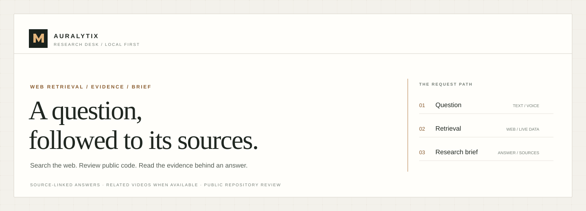
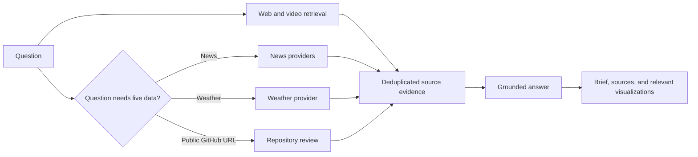

<div align="center">
  
</div>

# AURALYTIX

Search the web, inspect public GitHub repositories, and get a source-linked research brief with related videos when available. News and local weather are added when a question calls for them.

## Run locally on Windows

**Requirements:** Node.js 20 or newer, npm, and Python 3.10 or newer.

1. Copy `backend/.env.example` to `backend/.env` and add a reasoning provider key if you want generated answers. Keep real keys in `.env`.
2. Double-click **Start AURALYTIX.bat**, or open PowerShell in the project folder and run:

   ```powershell
   npm run dev
   ```

The launcher prepares missing dependencies, starts the backend, checks its health, starts the frontend, and opens the app. Keep its terminal open while using AURALYTIX. Press Ctrl+C to stop both services.

| Local service | Address |
| --- | --- |
| Research desk | <http://localhost:3000> |
| Backend health | <http://localhost:8010/health> |
| API reference | <http://localhost:8010/docs> |

In the search field, **Enter** submits the question and **Shift+Enter** adds a line break.

## Vercel deployment

The root vercel.json defines two services: the FastAPI API at /api/* and the Vite frontend at /. In Vercel project settings, set the project framework to Services. The frontend rewrites preserve React Router deep links, while /assets/* and /favicon.svg are served from the Vite build.

Run vercel dev -L from the repository root to exercise the service routing locally. Set backend provider secrets in the Vercel project environment; do not commit .env files. Complete the public-launch requirements below before promoting a deployment.

## What it does

- Searches the full question and related topic terms, then ranks retrieved pages against the complete request.
- Returns related YouTube videos when the public video provider has results.
- Adds current news or weather data when relevant.
- Displays retrieved results as soon as the bounded search pass completes. When a reasoning provider is configured, the brief updates automatically as soon as its grounded answer is ready.
- If reasoning is unavailable, the source-based brief, links, and excerpts remain available.
- Reviews public GitHub repositories using their metadata and a small set of text files. Repository code is never executed.
- Supports voice input through the configured speech provider or a locally installed Whisper model.
- Keeps follow-up context in local SQLite storage. Conversation text expires after 24 hours.

The public search, news, weather, and video fallbacks are free to use and do not require paid API subscriptions. Their availability and response time depend on the providers. Search and reasoning calls have bounded network waits so one slow provider does not hold a request indefinitely.

## Request path



## Project map

| Path | Purpose |
| --- | --- |
| `frontend/` | React and Vite research desk |
| `backend/` | FastAPI API, retrieval providers, reasoning, speech, and local session history |
| `dev.mjs` | One-command local service launcher |
| `Start AURALYTIX.bat` | Double-click Windows launcher |
| `DESIGN_AND_LAUNCH_GATES.md` | Product design rules and public-launch requirements |

## Provider setup

Set `LLM_PROVIDER` and the matching key in `backend/.env` for OpenRouter, Groq, OpenAI, or a local Ollama instance. Without a configured reasoning provider, AURALYTIX still returns retrieved sources and a source-based response. Optional paid search integrations remain off unless `ENABLE_PAID_APIS=true`; public fallbacks are used by default.

Search questions are sent to the providers needed to retrieve results. Follow-up context is stored in the local SQLite database for up to 24 hours. Review the provider settings and retention behavior before using this project with sensitive queries.

## Public launch requirements

A GitHub repository is source code, not website hosting. Complete and verify the custom domain, favicon, hosting-badge removal, privacy policy, terms and conditions, operator identity, support contact, governing law, and actual provider and retention disclosures before deploying the website. The current legal pages still need their operator-specific details. See [DESIGN_AND_LAUNCH_GATES.md](DESIGN_AND_LAUNCH_GATES.md).
